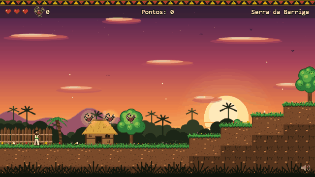
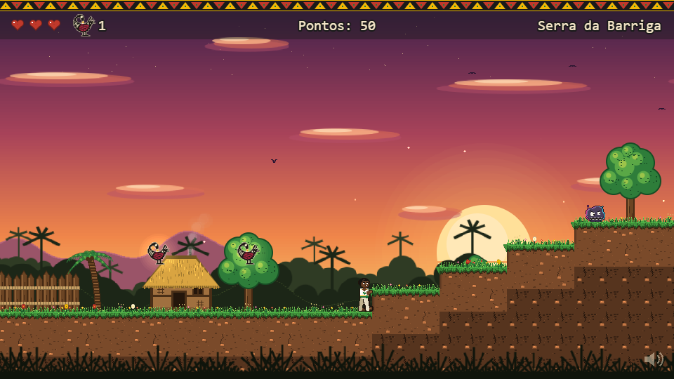
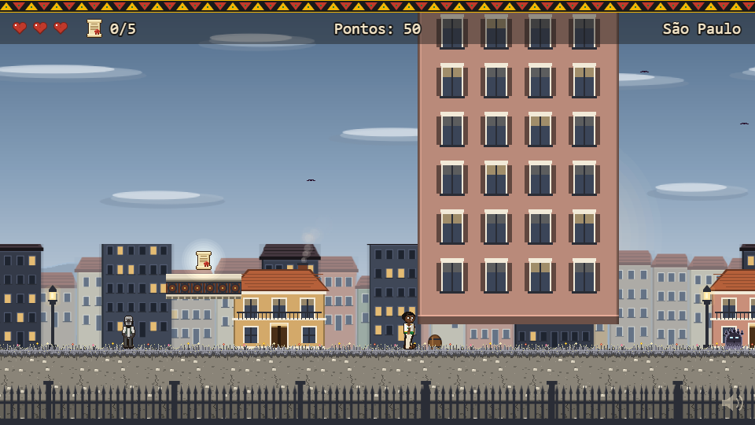
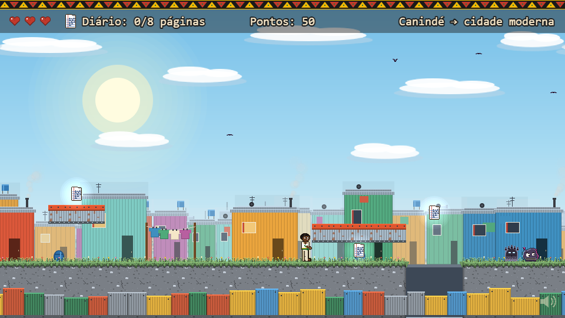
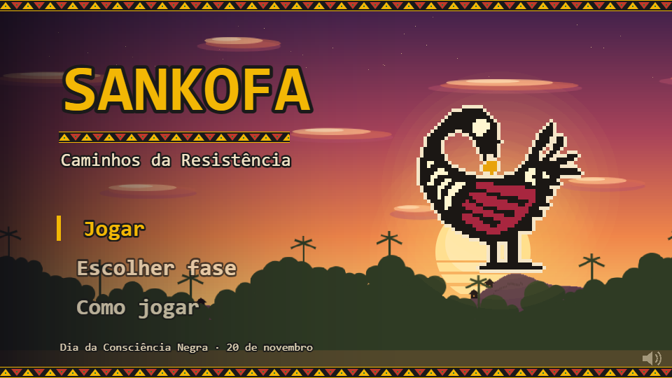

# Sankofa: Caminhos da Resistência

**Jogo de plataforma 2D no navegador** sobre a história da resistência negra no Brasil, feito para o Novembro Negro / Dia da Consciência Negra.

**[▶ Jogar agora](https://nathdomin.github.io/sankofa/)** (PC ou celular deitado, sem instalar nada)



> 🇬🇧 *A 2D browser platformer about Black resistance in Brazilian history. A young capoeirista travels through three eras, learning from Zumbi dos Palmares, Luiz Gama and Carolina Maria de Jesus. Built with Phaser 3 + strict TypeScript; every sprite, background and song is generated in code, with no image or audio files. [Play it here](https://nathdomin.github.io/sankofa/).*

## A história

Aiyê, estudante e capoeirista, precisa apresentar um trabalho sobre história negra e não sabe por onde começar. Um símbolo Sankofa ("voltar e buscar o que ficou para trás") leva Aiyê de volta no tempo, por três fases e três mentores:

| Fase | Época | Mentor | Objetivo |
|---|---|---|---|
| Serra da Barriga | Século XVII | Zumbi dos Palmares | Subir a serra do Quilombo dos Palmares |
| São Paulo | Século XIX | Luiz Gama | Recuperar 5 cartas de alforria e libertar 5 pessoas |
| Canindé → cidade moderna | Século XX | Carolina Maria de Jesus | Juntar as páginas do diário e chegar à biblioteca |

Ao fim de cada fase, uma carta histórica conta quem foi o mentor.

| | |
|---|---|
|  |  |
|  |  |

## Como jogar

| Ação | Teclado | Celular |
|---|---|---|
| Mover | ← → ou A / D | ◀ ▶ |
| Pular / aú (pulo duplo) | Espaço, ↑ ou W | botão de pulo |
| Meia-lua de compasso (golpe) | J ou X | botão de golpe |
| Esquiva (segurar) | ↓ ou S | ▼ |
| Pausar / mutar | Esc ou P / M | botões no canto |

Os inimigos são **ideias, não pessoas**: a *Desinformação* e o *Esquecimento*.

## Destaques técnicos

- **Phaser 3 + TypeScript `strict`**, sem `any`, empacotado com **Vite**.
- **Zero arquivos de arte ou som:** todas as texturas (personagem, inimigos, cenários com parallax, retratos animados) são desenhadas em código a partir de grades de pixel em texto, e toda a música e os efeitos são **sintetizados com a Web Audio API** (trilhas de capoeira e samba em estilo chiptune, com berimbau, atabaque e pandeiro).
- **Game feel de plataforma:** pulo variável, *coyote time*, *jump buffer*, *hit-stop*, *squash & stretch*, câmera que olha à frente.
- **Movimentos de capoeira** numa máquina de estados (ginga, aú, meia-lua, esquiva) com hitbox separada do sprite.
- **Fases em mapas ASCII** e uma ferramenta própria ([tools/reachability.mjs](tools/reachability.mjs)) que simula os pulos e avisa se algum coletável ou o portal ficou inalcançável.
- **Controles de toque** com multitoque, tela cheia e trava de orientação no celular.
- Conteúdo (textos, cartas históricas, mapas, músicas) separado da lógica em [src/data/](src/data/).

## Rodar localmente

```bash
npm install
npm run dev      # http://localhost:5173  (?debug mostra as hitboxes)
npm run build    # gera o dist/
node tools/reachability.mjs 0   # checa o alcance da fase 1 (0, 1 ou 2)
```

## Créditos

Desenvolvimento, arte e som: **Nathan Domingues**.
Os textos históricos foram conferidos em fontes públicas; as falas dos mentores são inspiradas e não citações reais. Não existe retrato de Zumbi feito em vida: o do jogo é imaginado.
